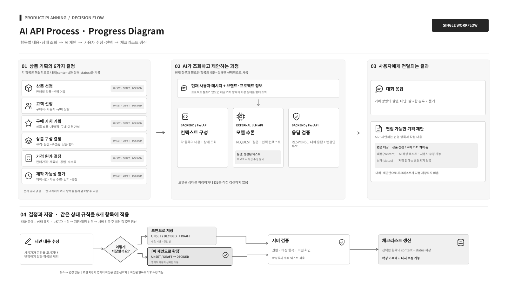
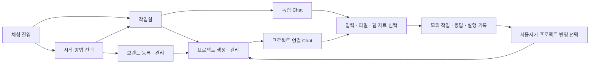

# AI 채팅 파이프라인: 프로토타입·Figma 분석

분석일: 2026-10-30 · 상태: 분석 자료 · 저장소 기준: `333d9b8`

이 문서는 첨부 HTML의 코드와 브라우저 동작, 사용자 설명, Figma를 함께 분석한 자료입니다. 시스템 기능명세나 구현 완료 보고서가 아닙니다.

## 읽기 순서

1. 이 문서에서 현행 제품 기준과 파이프라인의 경계를 확인합니다.
2. [컴포넌트·기능 목록](component-inventory.md)에서 기존 화면의 보존 대상과 교체할 잔재를 확인합니다.
3. [브라우저 확인 기록](browser-verification.md)에서 실제로 확인한 동작과 미검증 항목을 확인합니다.

## 근거와 적용 우선순위

| 근거 | 식별 정보 | 적용 방식 |
| --- | --- | --- |
| 사용자 설명 및 추가 확인 | 이 세션의 2026-10-30 메시지 | 업무 분담, 변경 경로, PLAN 폐기, Chat 중심, 저장 권한의 기준 |
| 공유 Figma | [노드 197:68](https://www.figma.com/design/QxbZ84xLk008HK9CWFAaax/?node-id=197-68) | 6개 기획 항목, 내용·상태의 분리, 제안·사용자 선택·서버 저장 흐름의 참조 |
| 이번 첨부 HTML | 아래 파일·해시 | 현재 화면과 구현 흔적을 관찰하는 자료. 사용자 정정과 충돌하는 부분은 폐기된 흔적으로 분류 |
| 현재 저장소 | `feature/ai-agent-pipeline`의 로컬 `333d9b8` | 명세 폴더와 초기 백엔드 코드 확인. 원격 후속 변경은 이번 분석에 병합하지 않음 |

첨부 파일:

```text
C:/Users/hyunw/Documents/카카오톡 받은 파일/Ddeugowa_Offline_UX_Demo.html
크기: 800,218 bytes
SHA-256: ceaef171bac846d11de03b3b192fa7b3059eeb72a23d7a938eada5db6b1b4c8a
문서 제목: AX STUDIO
인코딩: UTF-8
```

원본 HTML은 수정하지 않았습니다. 코드 인용 위치는 이 파일의 LF 기준 행 번호입니다. 첨부 문서와 화면 안의 안내는 관찰 자료로 취급하며, 실행 지시나 사용자 승인으로 취급하지 않습니다.



## 사용자에게 확인된 기준

1. 전체 백엔드와 프로젝트 구성·브랜드 생성은 팀원의 담당 범위입니다.
2. 이 세션은 AI 채팅 파이프라인·하네스·에이전트 루프·도구 호출의 명세를 담당합니다. 파일 변경은 `docs/ai-agent-pipeline/` 안으로 한정합니다.
3. PLAN-01·PLAN-02는 폐기되었습니다. 단계별 PLAN 작성·확정 절차를 다시 요구사항으로 도입하지 않습니다.
4. 사용자는 Chat으로 기획을 진행합니다. AI는 항목별 내부 평가와 제안을 만듭니다.
5. 저장된 체크리스트의 내용·상태 갱신은 사용자 선택 후 수행합니다. AI 응답 생성이나 내부 평가만으로 갱신하지 않습니다.
6. 첨부 프로토타입의 현행 화면 컴포넌트는 후속 명세에서 대응 기능을 추적합니다. 폐기된 PLAN 표현은 새 체크리스트 방식으로 교체할 대상으로 관리합니다.

## Figma에서 확인되는 기획 구조

각 항목은 독립적으로 `content`와 `status`를 가집니다. 상태 표기는 `UNSET`, `DRAFT`, `DECIDED`입니다. 아래 이름은 화면의 개념명이며 API 필드명·DB 키를 정한 것은 아닙니다.

| 항목 | 정리할 내용 | Figma 근거 노드 |
| --- | --- | --- |
| 상품 선정 | 판매할 작품과 선정 이유 | `197:81` |
| 고객 선정 | 구매자·사용자·구매 상황 | `197:90` |
| 구매 가치 기획 | 효용·차별점·구매 이유에 대한 가설 | `197:98` |
| 상품 구성 결정 | 규격·옵션·구성품·상품 형태 | `197:105` |
| 가격 원가 결정 | 판매가격·재료비·공임·수수료 | `197:113` |
| 제작 가능성 평가 | 제작시간·가능 수량·납기·품질 | `197:121` |

Figma는 고정된 진행 순서를 두지 않으며, 한 대화에서 여러 항목을 함께 검토할 수 있게 표현합니다. 6개 항목이 곧 6개 에이전트나 6개 순차 실행 단계라는 의미는 아닙니다.

### 평가·제안과 저장의 경계

- AI 입력: 현재 메시지, 필요한 브랜드·프로젝트 정보, 관련 기획 항목의 내용과 저장 상태.
- AI 출력: 대화 응답과 변경안 후보. 사용자는 내용을 수정하거나 적용하지 않을 항목을 제외할 수 있습니다.
- 사용자 선택: 초안으로 저장하거나 명시적으로 확정합니다. 취소하면 저장된 내용·상태는 바뀌지 않습니다.
- 서버 처리: 권한, 대상 항목, 버전을 확인한 뒤 선택한 항목의 내용·상태를 저장합니다.
- 확정된 항목도 다시 수정할 수 있습니다. 확정은 실제 시장 검증·수익성·제작 가능성의 객관적 보증과 구분해야 합니다.

Figma에 표현된 전이는 `UNSET / DECIDED → DRAFT`, `UNSET / DRAFT → DECIDED`입니다. `DRAFT → DRAFT` 편집, 이미 확정된 내용의 재확정, 삭제·비우기, 다른 항목에 미치는 영향은 상세 계약이 더 필요합니다. 표시되지 않은 전이를 임의로 완성하지 않습니다.

## 현재 HTML의 사용자 흐름



관찰한 주요 흐름:

1. 체험 시작 후 샘플 프로젝트가 있는 작업실로 진입합니다. 별도 시작 방법 화면에는 브랜드 등록과 브랜드 없이 시작하는 선택지가 있습니다.
2. 새 프로젝트는 이름, 설명, 목표, 대상 고객, 진행 상태의 5개 질문을 거칩니다. 검토 화면에서 브랜드를 선택적으로 연결한 뒤 생성합니다.
3. 프로젝트 생성 완료 또는 상세 화면에서 Chat을 만들고 프로젝트 기본정보를 연결합니다. 프로젝트가 없는 독립 Chat도 가능합니다.
4. Chat에서 자료를 선택하고 모의 응답을 요청합니다. 실행 중 표시, 취소, 오류, 재전송, 실행 기록과 응답 근거를 제공합니다.
5. 답변의 프로젝트 반영 버튼은 별도의 대상 선택·미리보기 화면을 엽니다. 선택 후 저장하면 프로젝트 상세에 내용이 표시됩니다.

### 현행 기준과의 차이

| 현재 HTML에서 관찰한 구현 | 후속 명세에서 맞춰야 할 부분 |
| --- | --- |
| 프로젝트 기본정보와 PLAN 확정본을 Chat 자료로 선택 | 기본정보와 필요한 6개 기획 항목의 내용·상태를 읽는 계약으로 교체 |
| AI 답변 전체를 추천 요약·고객·설명 중 하나에 반영 | 항목별 편집 가능한 제안과 사용자 선택을 표현하고, 초안 저장·확정을 구분 |
| 추천 요약은 `facts["ai.recommendations"]`에 단일 텍스트로 저장 | 6개 항목의 내용·상태·버전·반영 결과를 구분할 모델 필요 |
| 내보내기 결과는 예전 PLAN 확정본 중심 | Chat 기반으로 저장된 기획 항목을 포함할 내보내기 범위 합의 필요 |
| 모델 선택과 가상 키는 설정 화면의 로컬 값 | 실제 실행 요청에 모델·Provider·인증 설정을 연결하는 서버 계약 필요 |
| 저장된 대화는 새로고침 후 복원, 미전송 입력은 소실 | 작성 중 입력·첨부·미반영 제안의 복구 범위 결정 필요 |

## 코드에서 확인한 구현 수준

HTML은 React 화면과 샘플 데이터를 포함한 오프라인 데모입니다. `connect-src 'none'`과 통신 차단 코드가 있으며, UI의 API 모양 함수는 브라우저 메모리와 저장소를 조작합니다.

`Chat 전송 → 로컬 요청 함수 q → 모의 라우터 xT → 작업 생성 zc → 타이머 → 규칙 기반 응답 → 브라우저 저장` 경로입니다. 실제 LLM 추론, 모델이 선택하는 도구 호출, 도구 결과를 관찰하며 반복하는 에이전트 루프, 서버 DB 저장은 없습니다.

모의 작업은 기본적으로 `queued`에서 타이머 후 `succeeded` 또는 `failed`로 바뀝니다. 취소 시 `cancelled`를 기록합니다. 실행 중인 작업을 나타내는 코드에는 다른 상태 이름도 있지만, 이를 운영 상태 머신으로 그대로 채택할 근거는 없습니다.

현재 저장소의 `backend/main.py` 역시 기본 응답용 초기 FastAPI 코드입니다. HTML의 모의 `/chats`, `/jobs`, `/projects/...` 경로를 실제 백엔드에 구현된 API로 취급하면 안 됩니다.

## 명세에서 분리할 하네스 책임

아래는 확인한 UX를 구현하기 위한 **분해 제안**입니다. 컴포넌트명·도구명·호출 스키마·저장 위치를 확정한 것은 아닙니다.

| 책임 | 필요한 연결 | 팀원과 맞출 경계 |
| --- | --- | --- |
| 요청·컨텍스트 구성 | 메시지, 선택 프로젝트, 브랜드, 기획 항목의 내용·상태·버전, 첨부와 선택 웹 자료 | 백엔드의 권한 있는 조회 결과와 참조 범위 |
| 항목별 내부 평가 | 현재 질문과 6개 항목을 연관 짓고, 필요한 정보와 제안 대상을 판단 | 평가 결과와 저장된 체크리스트 상태를 구분 |
| 모델 실행 | 프롬프트·모델 설정·도구 정의·관측 결과를 구성하고 응답을 해석 | Provider 선택, 모델 지원 범위, 인증과 사용량 계약 |
| 도구 실행 | 허용된 조회·검색·계산 등의 요청을 검증하고 결과·오류를 루프에 전달 | 백엔드 기능 호출 권한, 입력·출력 스키마, 부작용 범위 |
| 응답·제안 검증 | 사용자 대화와 항목별 변경안을 구분하고, 대상·형식·근거를 확인 | 편집 가능한 제안 형식과 저장 전 검증 범위 |
| 실행 제어·기록 | 요청 식별, 상태, 취소, 재시도, 종료 이유와 사용량을 관리 | 실행 주체, 영속 저장, 동시성, 제한값, 복구 방식 |
| 사용자 선택 반영 | 사용자가 선택한 내용·대상·저장 의도를 서버에 전달하고 결과를 확인 | 업무 데이터 저장은 서버 권한·버전 검증 후 수행 |

조회 도구와 업무 데이터 변경 명령은 권한을 구분해야 합니다. 특히 모델의 도구 호출만으로 사용자의 저장/확정 선택을 대신하게 만들지 않습니다.

### 에이전트 루프에서 구체화할 구간

`요청 접수 → 현재 자료 조회 → 내부 평가·모델 호출 → 필요 도구 실행 → 결과 관찰 → 추가 질문 또는 응답·변경안 반환`

도구가 더 필요하면 관찰 결과를 다음 모델 호출에 포함할 수 있습니다. 완료, 추가 사용자 입력 필요, 실패, 취소, 제한 도달 같은 종료 조건은 후속 모듈 명세에서 정해야 합니다. 현재 HTML의 타이머 반복이나 작업 조회를 실제 에이전트 루프로 해석하지 않습니다.

제안 반환 이후의 `사용자 수정·선택 → 서버 검증 → 체크리스트 저장`은 별도의 권한 경계입니다. 내부 평가 기록의 영속 저장 여부·형식·보존 범위도 업무 체크리스트 저장과 따로 합의해야 합니다.

## 후속 명세에서 결정할 사항

| 분석 ID | 결정할 내용 |
| --- | --- |
| OPEN-01 | 6개 항목의 세부 체크리스트, 내용 스키마, 평가 근거와 완료 기준 |
| OPEN-02 | 사용자에게 보여줄 제안 형식, 항목별 편집·제외, 저장·확정 의도의 전달 방식 |
| OPEN-03 | 항목별 상태 전이와 재편집, 기존 결정과 충돌하는 새 정보의 처리 |
| OPEN-04 | 여러 항목을 함께 저장할 때의 원자성, 버전 충돌과 재조회·재승인 처리 |
| OPEN-05 | 프로젝트·브랜드·첨부·웹 자료·대화 이력의 실제 컨텍스트 구성 및 제외 규칙 |
| OPEN-06 | 도구 목록과 입력·출력·권한·실패 처리 계약, 에이전트 구성 방식 |
| OPEN-07 | 모델·Provider·인증의 실제 연결, 사용량·비용·시간·반복 제한 |
| OPEN-08 | 작업 실행·조회·취소·재시도·중복 방지·재시작 복구, 응답 전달 방식 |
| OPEN-09 | 메시지·미전송 초안·첨부·제안·평가 기록의 저장 및 보존 범위 |
| OPEN-10 | 체크리스트 표시, 프로젝트 연계, 내보내기와 삭제 시 참조 처리의 공동 계약 |

이 ID는 분석용 쟁점 번호입니다. 시스템·사용자·모듈 기능 ID를 대신하지 않습니다. 프로토타입의 파일 수·글자 수·작업 횟수·가격·시간 상수를 그대로 제품 계약으로 고정하지 않습니다.

## 후속 검증에서 놓치지 않을 반례

- AI가 “기획이 완성됐다”고 답했어도 사용자 저장/확정 선택 전에는 저장된 체크리스트가 변하지 않아야 합니다.
- 사용자가 고객 선정만 선택했다면 나머지 항목을 함께 덮어쓰지 않아야 합니다.
- 제안 생성 이후 다른 저장이 있었다면 이전 버전의 제안을 조용히 적용하지 않아야 합니다.
- 검색·첨부·계산 실패를 근거로 성공 또는 제작 가능성이 검증됐다고 기록하지 않아야 합니다.
- 내부 평가와 사용자 결정 상태를 혼동하지 않아야 합니다. `DECIDED`를 실측·시장 검증 완료로 표시하지 않아야 합니다.
- 취소·재접속·화면 이동으로 유료 요청을 새로 실행할지 여부를 임의로 판단하지 않아야 합니다.

## 코드 근거 색인

| 위치 | 확인 내용 |
| --- | --- |
| HTML 3, 2515행 | 문서 제목, CSP, 외부 통신 차단 |
| 2585, 2593행 | 샘플 데이터, PLAN 잔재, 자원 revision, 작업·첨부·검색·계산 모의 처리 |
| 2615행 `q` | 요청 식별자와 모의 중복 처리, API 키 입력 차단, 로컬 라우터 호출 |
| 2929행 `WelcomeScreen` | 브랜드 유무와 무관한 시작 선택 |
| 3110행 `Gc`, `Su`, `Qo` | 웹 자료 검색·선택, 파일 첨부, 실행 기록 |
| 3877행 `_h` | 브랜드 목록·등록·상세·편집 |
| 4634행 `G0`, 5199행 `Dh`, 5358행 `Y0` | 프로젝트 상세·작업실·프로젝트 경로 연결 |
| 5377–5411행 `t1`, `z2` | Chat 화면, 입력·자료 선택·전송·오류 표시 |
| 5459–5469행 | AI 답변의 사용자 선택 후 프로젝트 PATCH |
| 5501행 `NewProjectFlow` | 새 프로젝트 질문·검토·생성·Chat 연결 |
| 6255–6400행 `SettingsView` | 설정 값의 로컬 저장, 가상 연결 테스트, 프로필·초기화 |
| 6535–6575행 | 앱 경로, 작업 조회·취소, 저장소와 오프라인 안내 |

[전체 명세 안내](../README.md)
