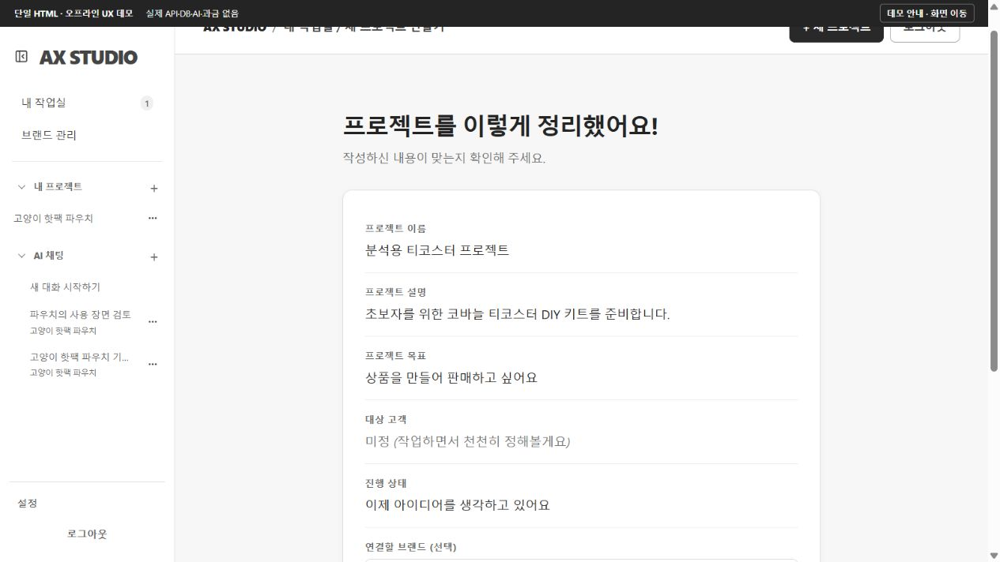
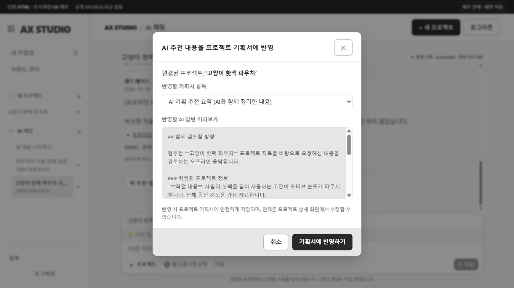
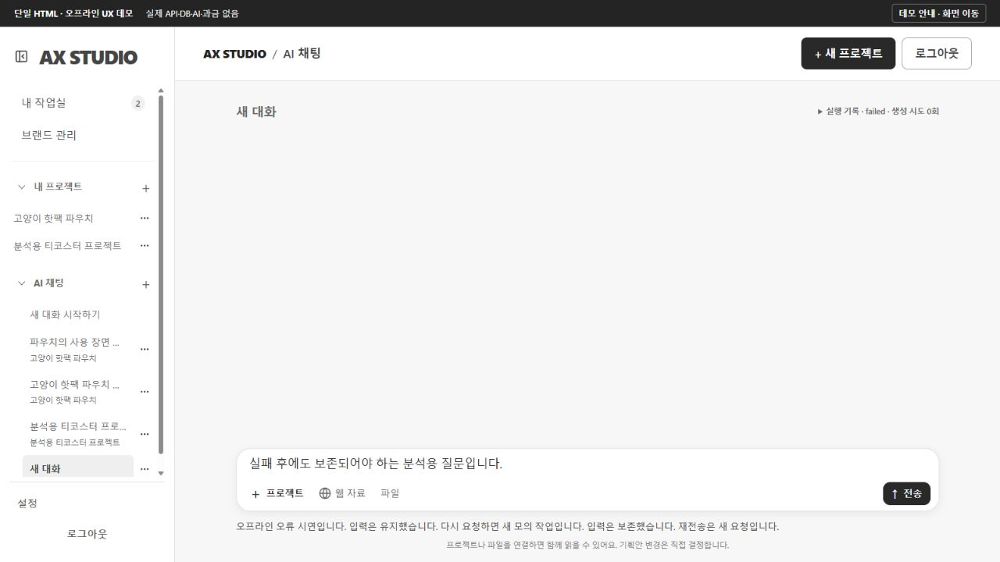

# 브라우저 관찰 기록

분석일: 2026-10-30 · 대상 파일과 해시: [분석 개요](README.md)

## 확인 환경과 범위

- 첨부 HTML 한 파일만 반환하는 임시 HTTP 서버를 `127.0.0.1`에 열고 인앱 브라우저에서 확인했습니다. 같은 폴더의 다른 파일은 제공하지 않았습니다.
- `file://` 직접 실행을 검증한 것은 아닙니다.
- 브라우저의 데모 전용 저장소에 분석용 프로젝트·대화를 만들었습니다. 실제 서비스 API, MongoDB, LLM, 검색 Provider에는 연결하지 않았습니다.
- 실제 API 키 입력·발급·저장, 실제 계정 로그인, 서비스 데이터 삭제, 첨부 원본 수정은 수행하지 않았습니다.
- Figma 노드 `197:68`은 Figma 도구로 구조·텍스트·렌더를 읽었습니다. Figma 자체를 편집하거나 실제 서비스의 체크리스트 저장을 검증한 것은 아닙니다.

## 상태 표기

- `OBSERVED`: 브라우저에서 해당 동작이나 화면을 직접 확인했습니다.
- `GAP`: 실제 동작에서 확인한 차이·누락입니다. 아직 합의되지 않은 인수 기준에 대한 최종 FAIL을 의미하지 않습니다.
- `STATIC_ONLY`: 관련 코드를 읽었지만 해당 동작을 직접 실행하지 않았습니다.
- `NOT_RUN`: 이번 검증에서 실행하지 않았습니다.
- `DEPRECATED`: 사용자가 폐기한 기능 또는 그 잔재입니다.

## 확인한 흐름

| ID | 절차 | 실제 관찰 | 상태 |
| --- | --- | --- | --- |
| B-01 | 첫 화면에서 체험 시작 | 샘플 프로젝트가 있는 작업실로 진입. 실제 인증 화면 없이 데모 세션 사용 | OBSERVED |
| B-02 | 작업실 → 프로젝트 상세 | 기본정보, 브랜드 연결, 사진, AI 대화, 정리한 내용, 내보내기·삭제 진입점 표시 | OBSERVED |
| B-03 | 프로젝트 상세 → AI와 대화 | 새 Chat이 생성되고 프로젝트 기본정보 카드가 연결됨 | OBSERVED |
| B-04 | Chat의 프로젝트 자료 선택 | 기본정보와 예전 PLAN 확정본 체크박스 선택 후 카드에 표시 | OBSERVED / PLAN 선택은 DEPRECATED |
| B-05 | 웹 자료 → 검색 → 결과 펼침 | 모의 검색 작업 후 요약·예시 출처·비용 표시, 다음 요청 첨부 선택 제공 | OBSERVED |
| B-06 | 프로젝트·웹 자료 선택 후 전송 | 작업 배너와 queued 표시 후 모의 답변·자료 이름·응답 정보·선택한 웹 자료 표시 | OBSERVED |
| B-07 | 답변의 프로젝트 반영 버튼 | 대상 선택·답변 미리보기·취소·저장 대화상자 표시 | OBSERVED |
| B-08 | 추천 요약에 저장 → 프로젝트 확인 | 성공 알림 후 프로젝트의 AI 정리 영역에 답변이 표시됨. 전송과 저장이 별도 동작임을 확인 | OBSERVED |
| B-09 | 브랜드 목록·상세·수정·새 등록 | 브랜드 정보·연결 프로젝트·등록/편집 필드·선택적 로고·예시 입력 표시 | OBSERVED; 신규 등록 저장은 NOT_RUN |
| B-10 | 새 프로젝트 5개 질문 진행 | 이름·설명·목표·고객·단계 입력. 고객 미정 선택 가능 | OBSERVED |
| B-11 | 검토 → 브랜드 없이 생성 → AI 시작 | 생성 완료 표시 후 새 프로젝트와 연결된 Chat으로 이동 | OBSERVED |
| B-12 | 안내의 샘플 PLAN-01·PLAN-02 클릭 | URL은 PLAN 경로가 되지만 화면은 프로젝트 상세. 사용자는 두 PLAN을 폐기했다고 명시 | DEPRECATED |
| B-13 | 설정 화면 → 연결 테스트 | 가상 API 성공과 지연 시간이 표시됨. 코드상 타이머와 임의 값으로 생성하며 실제 연결 증거가 아님 | OBSERVED |
| B-14 | API 키 안내 열기·닫기 | 공급자별 안내·가상 키 버튼 확인. 외부 사이트 이동이나 키 생성·입력은 하지 않음 | OBSERVED |
| B-15 | 프로젝트 없는 새 Chat | 독립 대화의 시작 안내와 추천 질문·자료 도구 표시 | OBSERVED |
| B-16 | 다음 AI 요청 실패 시연 → 전송 | failed 표시와 오류 안내. 입력창에 질문이 남아 있음 | OBSERVED |
| B-17 | 같은 입력 재전송 → 즉시 취소 | cancelled 표시. 새 응답은 추가되지 않고 입력은 유지됨 | OBSERVED |
| B-18 | 취소 후 재전송 | 새 작업이 succeeded가 되고 사용자 메시지·모의 답변이 표시됨 | OBSERVED |
| B-19 | Chat 이름 변경 → 새로고침 | 변경된 이름과 완료된 대화 이력이 복원됨 | OBSERVED |
| B-20 | 미전송 텍스트 입력 → 새로고침 | 입력창 값이 빈 문자열로 돌아옴. 완료 대화의 복원과 미전송 초안 복원은 다름 | GAP |
| B-21 | 시작 방법 선택 화면 | 브랜드 등록과 브랜드 없이 시작하는 두 경로 표시 | OBSERVED |
| B-22 | 마지막 데모 안내·콘솔 확인 | 현재 페이지 안내상 추가 HTTP 리소스 0개·차단 통신 시도 0회. 수집된 콘솔 warn/error 없음 | OBSERVED |

위 확인은 오프라인 화면·모의 동작에 한정됩니다. 전체 서비스 UAT, 실제 모델의 품질, 인증·권한, 서버의 동시성·정합성·보안 검증으로 확대 해석하지 않습니다. B-22의 수치는 최종 페이지에서 표시된 감사 값이며 브라우저의 모든 통신을 독립 캡처한 패킷 기록은 아닙니다.

## 실행하지 않은 항목

| 항목 | 상태·이유 |
| --- | --- |
| 실제 파일 업로드와 잘못된 형식·크기·개수의 경계값 | STATIC_ONLY. 입력 UI와 검사 코드는 확인했으나 파일 선택·업로드는 실행하지 않음 |
| 프로젝트·브랜드·대화의 삭제와 초기화·복원 | STATIC_ONLY. 데이터 변경이 필요하지 않아 코드와 관련 컨트롤만 분석 |
| JSON 내보내기 파일의 다운로드·내용 검사 | STATIC_ONLY. 반환 구조를 코드에서 확인. Chat 정리 내용과 예전 PLAN 중심 내보내기 사이의 차이를 분석에 기록 |
| 버전 충돌·중복 요청·세션 만료·실행 중 새로고침 | STATIC_ONLY. 관련 구현 흔적은 있으나 운영 수준 검증은 수행하지 않음 |
| 실제 멀티모달 모델 입력, 외부 검색, 도구 선택·반복 실행 | NOT_RUN. 이 HTML에 실제 연결이 없음 |
| 새 6개 항목의 내부 평가·편집 제안·초안/확정 저장 | NOT_RUN. Figma와 사용자 설명으로 기준을 확인했으며, HTML에 구현된 것은 아님 |
| 실제 MongoDB 저장·원자성·재시작 복구 | NOT_RUN. 프로토타입은 브라우저 저장소를 사용 |

## 화면 기록

### 프로젝트 생성 전 검토

### Chat 답변의 사용자 선택 후 반영

현재 프로토타입은 답변 전체를 하나의 대상 필드에 반영합니다. 후속 명세에서는 Figma의 항목별 편집 제안과 초안/확정 선택으로 연결해야 합니다.

### 실패 후 입력 보존

### 데모 설정과 통신 안내

- [가상 연결 테스트 화면](evidence/settings-mock-connection.png)
- [최종 오프라인 통신 안내](evidence/offline-audit.png)
- [폐기된 PLAN 경로에서 나타나는 현재 프로젝트 상세](evidence/plan-route-current-detail.png)
- [Figma 참조 렌더](evidence/figma-197-68.png)

[분석 개요](README.md) · [컴포넌트·기능 목록](component-inventory.md)
