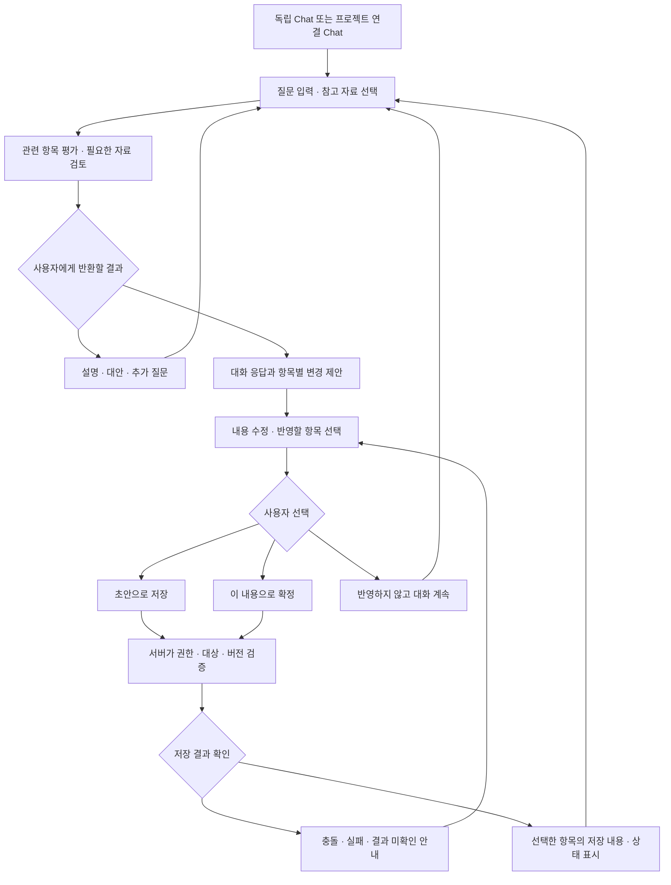

# AI 파이프라인 사용자 기능명세 v0.1

작성일: 2026-10-30 · 문서 상태: **초안 / 사용자 검토 중 · 일부 계약 결정** · 상위 시스템 기능명세: **작성 및 연결 대기**

이 초안은 사용자 설명·추가 확인과 [프로토타입·Figma 분석](../00-prototype-analysis/README.md)을 근거로 작성합니다. 상위 시스템 기능명세가 준비되면 기능 범위와 추적 관계를 대조해야 합니다. 현재의 기능 ID는 이 초안의 문서 식별자이며 API·DB·도구 이름이 아닙니다.

## 1. 목적과 범위

사용자가 Chat으로 상품 기획을 발전시키고, AI가 6개 체크리스트 항목을 검토하여 대화와 변경안을 제공하며, 사용자가 선택한 내용만 초안 또는 확정 상태로 저장하는 경험을 정의합니다.

- AI 파이프라인 범위: 대화·자료 참조, 항목별 평가, 필요한 도구를 통한 검토, 대화 응답·제안, 사용자 선택의 전달과 결과 확인, 실행 중단·오류·이력 안내.
- 공동 연계 범위: 프로젝트·브랜드 정보 조회, 파일·웹 자료, 모델 설정, 체크리스트 저장·버전 검증, 내보내기·삭제 시 참조 처리.
- 전체 백엔드와 프로젝트 구성·브랜드 생성은 팀원이 담당합니다. 이 문서는 그 구현이나 DB 계약을 대신 정하지 않습니다.
- PLAN-01·PLAN-02는 폐기된 기능입니다. 별도 PLAN 작성·확정 단계와 PLAN 확정본 첨부를 현행 기능으로 복원하지 않습니다.
- 실제 에이전트 수, 프레임워크, 도구 스키마, 반복 횟수, 통신 방식, 제한값은 모듈·공동 계약에서 결정합니다.

프로토타입의 전체 컴포넌트는 [기능 대응표](#9-프로토타입-컴포넌트와의-대응)로 추적합니다. AI 외의 화면을 이 초안에서 상세 정의하지 않은 것은 해당 기능을 폐기한다는 뜻이 아닙니다.

## 2. 근거와 문서 해석

| 구분 | 의미 | 이 초안에서의 적용 |
| --- | --- | --- |
| 확인된 기준 | 이 세션에서 사용자가 확인한 방향과 공유 Figma의 확인된 의미 | Chat 중심, PLAN 폐기, 6개 항목의 독립성, 사용자 선택 후 저장, 프로젝트 연결 Chat의 저장 대상 고정, 독립 Chat의 최초 프로젝트 연결·Projection 조회 |
| 기능 초안 | 위 기준을 사용자 동작·결과·예외로 구체화한 검토안 | 아래 UF-AI-01~15. 아직 개별 기능의 최종 합의를 뜻하지 않음 |
| 미정 계약 | 동작을 완성하기 위해 추가 합의가 필요한 부분 | [미정 계약 목록](open-contracts.md)의 OPEN-UF-01~15 |
| 관찰 자료 | 기존 HTML의 화면·모의 동작·코드 흔적 | 화면 누락 방지와 차이 분석에 사용. 실제 AI·서버 구현의 근거로 쓰지 않음 |

근거 문서:

- [분석 개요와 사용자 확인 기준](../00-prototype-analysis/README.md)
- [컴포넌트·기능 목록](../00-prototype-analysis/component-inventory.md)
- [브라우저 관찰 기록](../00-prototype-analysis/browser-verification.md)
- [Figma 노드 197:68](https://www.figma.com/design/QxbZ84xLk008HK9CWFAaax/?node-id=197-68)

상위 시스템 기능 ID는 아직 부여하지 않습니다. 후속 명세에서는 이 문서의 기능 ID와 시스템 기능 ID를 연결합니다.

## 3. 사용자와 핵심 개념

주 사용자는 작품·상품의 기획 방향을 고민하는 창작자입니다. 사용자는 프로젝트가 없는 독립 대화 또는 프로젝트를 연결한 대화를 시작할 수 있습니다. 실제 계정·역할·접근 권한은 공통 백엔드와 합의할 계약입니다.

| 개념 | 사용자 관점의 의미 | 저장된 체크리스트와의 관계 |
| --- | --- | --- |
| 대화 응답 | 질문에 대한 설명, 대안, 비교, 추가 질문 | 응답 자체로 항목 내용·상태가 바뀌지 않음 |
| 내부 평가 | 현재 자료로 무엇이 확인됐고 무엇이 부족한지에 대한 AI의 검토 | 평가 결과가 곧 저장 상태나 객관적 검증 완료를 뜻하지 않음 |
| 미저장 제안 | AI가 제시하고 사용자가 수정·선택할 수 있는 변경 내용 | 생성·편집만으로 기존 저장 내용을 바꾸지 않음 |
| 저장된 초안 | 사용자가 초안 저장을 선택하고 서버가 저장을 확인한 내용 | 해당 항목의 상태가 `DRAFT`인 저장 결과 |
| 확정된 내용 | 사용자가 명시적 확정을 선택하고 서버가 저장을 확인한 내용 | 해당 항목의 상태가 `DECIDED`인 저장 결과 |
| 실행 상태 | 요청이 진행·종료·실패·취소됐는지에 대한 정보 | 기획 항목의 `UNSET / DRAFT / DECIDED`와 별개 |
| 프로젝트 첨부·연결 | 독립 Chat에서 프로젝트를 처음 연결하고 그 프로젝트의 Projection 정보를 불러오는 동작 | 연결 이후 해당 프로젝트가 고정된 저장 대상이 됨. 첨부·조회만으로 내용·상태를 저장하지 않음 |

문서의 ‘초안’과 저장 상태 `DRAFT`도 서로 다른 개념입니다. 내부 평가·실행 기록·제안의 영속 저장 여부와 보존 범위는 OPEN-UF-12에서 결정하며, 업무 체크리스트를 자동 갱신할 권한으로 해석하지 않습니다.

`Projection`은 사용자가 이번 논의에서 불러올 프로젝트 정보를 지칭한 명칭입니다. 재검토 시작 직전의 재조회 시점은 공통 기준 14로 정했습니다. 구체적인 필드·조회 API·버전·그 밖의 갱신 방식·실제 모델 입력 범위는 아직 미정이며, 이 명칭을 확정된 스키마나 구현 이름으로 간주하지 않습니다. 프로젝트를 첨부하는 느낌은 기능 의도이며, 버튼·선택창·표시 위치 등 UX는 미정입니다.

## 4. 공통 동작 기준

1. Chat이 주 작업 흐름입니다. 6개 항목의 검토 순서를 강제하지 않으며 한 대화에서 여러 항목을 다룰 수 있습니다.
2. AI는 관련 자료를 평가하고 설명·추가 질문·편집 가능한 제안을 제공합니다. 매 응답에 6개 항목을 모두 채우거나 저장을 요구하지 않습니다.
3. 자료 조회, AI 평가, 도구 호출, 대화 응답, 제안 생성·편집만으로 저장된 체크리스트 내용·상태를 바꾸지 않습니다.
4. 사용자는 반영할 항목과 내용을 검토한 뒤 초안 저장 또는 확정을 선택합니다. 적용하지 않는 항목을 제외할 수 있습니다.
5. 서버는 권한·대상·버전을 검증하고 선택된 항목에 대해 반영 결과를 반환합니다. 저장 완료 표시는 확인된 결과에 근거합니다.
6. 확인하지 못한 정보·가정·사용자 입력·외부 자료·계산 결과를 혼동하지 않습니다. 미확인 비용이나 제작 조건을 임의의 사실로 채우지 않습니다.
7. `DECIDED`는 사용자의 기획 결정 상태입니다. 실제 시장 수요, 수익성, 납기나 품질이 검증됐다는 보증을 뜻하지 않습니다.
8. 여러 항목 저장의 원자성·부분 성공, 재편집 시 추가 전이 등 미정 사항은 아래 상태표와 OPEN 목록의 범위 안에서 다룹니다.
9. 프로젝트에 연결된 Chat의 체크리스트 저장 대상은 해당 프로젝트 하나로 고정합니다. 다른 프로젝트 작업은 새 Chat에서 시작하며, 기존 Chat이나 그 제안의 저장 대상을 다른 프로젝트로 바꾸지 않습니다. 이 기준은 저장 대상에 관한 결정이며, 다른 프로젝트의 읽기 전용 참조 허용 여부는 OPEN-UF-03에 남깁니다. 근거는 [미정 계약 목록](open-contracts.md)의 D-UF-001입니다.
10. 독립 Chat에서는 같은 대화에서 프로젝트를 최초 한 번 연결할 수 있습니다. 프로젝트를 첨부하듯 연결해 해당 프로젝트의 Projection 정보를 불러오며, 연결 이후에는 기준 9를 따릅니다. 구체적인 UX와 연결 전 이력·내부 평가의 모델 입력 취급은 별도 미정 계약입니다. 근거는 [미정 계약 목록](open-contracts.md)의 D-UF-002입니다.
11. 프로젝트 연결 전에 나온 제안은 연결된 프로젝트의 Projection 정보를 바탕으로 재검토한 뒤 프로젝트용 제안으로 저장할 수 있습니다. 재검토 없이 이전 제안을 바로 초안 저장·확정하지 않습니다. 사용자는 재검토 결과의 내용·항목을 확인하고 저장·확정을 선택하며, 재검토만으로 저장 내용·상태가 바뀌지 않습니다. 근거는 [미정 계약 목록](open-contracts.md)의 D-UF-003입니다.
12. 프로젝트 연결 시 Projection은 불러오되, 연결 전 제안의 재검토는 자동으로 실행하지 않습니다. 사용자가 명시적으로 재검토를 요청할 때 실행합니다. 프로젝트 연결이나 기존 제안의 저장 시도만을 재검토 요청으로 취급하지 않습니다. 요청의 구체적인 UX와 의도 식별의 세부 기준은 미정이며, 대상 처리에는 기준 13을 따릅니다. 근거는 [미정 계약 목록](open-contracts.md)의 D-UF-004입니다.
13. 명시적인 재검토 요청에서 대상 제안이 요청이나 문맥상 명확하면 추가 확인 없이 바로 실행합니다. 여러 해석이 가능한 경우에만 대상 확인 질문을 하고, 대상이 명확해진 뒤 실행합니다. 모호한 요청을 가장 최근 제안이나 연결 전 제안 전체로 임의 해석하지 않습니다. 사용자가 전체 제안 등 범위를 분명히 지정한 경우에도 반복 확인을 강제하지 않습니다. 근거는 [미정 계약 목록](open-contracts.md)의 D-UF-005입니다.
14. 명시적인 재검토 요청의 대상이 정해지면, 재검토를 시작하기 직전에 연결된 프로젝트의 Projection을 다시 조회하여 재검토 자료로 사용합니다. 연결 당시 불러온 정보만으로 재검토를 시작하지 않습니다. 재조회 실패의 복구는 미정이며, 실행 중 변경에는 기준 15를 따릅니다. 근거는 [미정 계약 목록](open-contracts.md)의 D-UF-006입니다.
15. 재검토는 시작 직전에 조회한 프로젝트 자료를 기준으로 완료하고, 실행 도중 바뀐 값으로 기준 자료를 섞어 바꾸지 않습니다. 완료 시 변경 여부를 확인하여 변경이 확인된 해당 제안은 이전 정보에 기반한 결과임을 표시하고 저장을 보류합니다. 사용자가 명시적으로 재요청하면 다시 조회해 재검토하며, 변경만으로 자동 재실행하지 않습니다. 변경 판정에는 기준 16을 따르며, 완료 후 저장까지의 충돌 처리는 미정입니다. 근거는 [미정 계약 목록](open-contracts.md)의 D-UF-007입니다.
16. 변경 여부는 프로젝트 전체의 공통 버전 하나로 판정하지 않고, 제안마다 실제 입력으로 제공하거나 검토 중 조회한 참조 자료 묶음과 그 기준 버전을 연결해 판정합니다. 저장 대상 항목의 버전도 별도로 검증하여 다른 편집을 덮어쓰지 않도록 합니다. Projection 전체를 AI에 전달했다면 전체 자료 묶음을 참조 범위에 포함하며, 모델의 사후 주장만으로 범위를 줄이지 않습니다. 체크리스트 외 자료 묶음의 경계·버전 형식과 완료 후 저장까지의 근거 재검증은 미정입니다. 근거는 [미정 계약 목록](open-contracts.md)의 D-UF-008입니다.
17. 여섯 체크리스트는 각각 내용·상태를 하나의 자료 묶음으로 버전 관리하되, 각 항목 내부에는 실제 사용자 문제를 분석할 하위 필드·질문·평가 기준을 둡니다. 버전 단위가 항목이라는 이유로 내용을 단일 문단이나 자유 텍스트 하나로 제한하지 않습니다. 하위 필드의 존재가 필드별 독립 버전·상태나 필수 입력 폼을 뜻하지는 않습니다. 정확한 하위 필드와 평가 기준은 OPEN-UF-02에서 합의합니다. 근거는 [미정 계약 목록](open-contracts.md)의 D-UF-009입니다.
18. 고객 접점·판매 경로 가설을 CK-02 고객 선정의 하위 필드로 포함해 저장·평가 대상으로 관리합니다. AI의 가설·제안만으로 저장하지 않으며 사용자 검토·저장·확정 선택과 서버 검증을 따릅니다. 경로 이름이 있다는 사실을 실제 고객 접근이나 구매 의사 검증으로 취급하지 않습니다. 연결 관계의 설계에는 기준 19를 따르며, 실제 필드·저장 구조·필수 입력·평가·완료 조건은 미정입니다. 근거는 [미정 계약 목록](open-contracts.md)의 D-UF-010입니다.
19. 고객 선정의 내부 내용은 구매 상황별 고객 가설로 관리합니다. 한 가설 안에서 구매자·사용자, 구매 목적·상황, 고객 접점·판매 경로와 접근 근거를 연결하고, 요소들이 서로 맞는지와 어떤 연결·근거가 부족한지 검토합니다. 독립된 값의 나열이나 다른 가설의 요소를 임의로 섞어 완성된 고객 가설로 취급하지 않습니다. 미정인 연결은 대화에서 점진적으로 구체화하며, 버전·저장 상태는 CK-02 단위를 유지합니다. 가설 개수·필수 입력·완료 조건·실제 저장 구조는 미정입니다. 근거는 [미정 계약 목록](open-contracts.md)의 D-UF-011입니다.

## 5. 전체 사용자 흐름

‘관련 항목 평가’ 중 필요한 도구를 사용할 수 있으나, 사용자가 내부 모델 호출 단계나 반복 구조를 직접 조작해야 한다고 가정하지 않습니다. 실패·충돌 후 재검토 방법과 결과 미확인 시의 복구는 UF-AI-13 및 미정 계약의 대상입니다.

### 5.1 독립 Chat

프로젝트 없이 아이디어를 질문하고 자료를 검토할 수 있습니다. 저장 대상 프로젝트가 없는 동안에는 특정 프로젝트의 체크리스트에 반영됐다고 표시하지 않습니다. 사용자는 같은 독립 Chat에서 프로젝트를 최초 한 번 연결하고 대화를 이어갈 수 있습니다. 프로젝트를 첨부하는 느낌으로 해당 프로젝트의 Projection 정보를 불러오며, 연결 이후 저장 대상은 그 프로젝트로 고정됩니다.

프로젝트 연결 전 제안을 저장하려면 5.4의 재검토 흐름을 거칩니다. 재검토 시작 직전에는 Projection을 다시 조회합니다. 프로젝트를 첨부·연결하는 구체적인 UX, Projection의 조회 범위·버전·그 밖의 갱신 방식, 연결 전 이력·내부 평가의 모델 입력 취급은 OPEN-UF-03에서 정합니다. 최초 연결을 허용한 결정만으로 이전 제안이 프로젝트에 맞게 검증됐거나 자동 저장됐다고 취급하지 않습니다.

### 5.2 프로젝트 연결 Chat

사용자가 연결한 프로젝트와 필요한 자료를 바탕으로 관련 기획 항목을 검토합니다. AI는 현재 질문과 저장된 내용·상태의 차이를 고려해 설명 또는 제안을 제공합니다. 사용자는 기존 저장 내용과 새 제안을 구분해서 검토하고, 반영 대상·내용·저장 의도를 선택합니다.

이 Chat의 체크리스트 저장 대상은 연결된 프로젝트 하나로 고정됩니다. 다른 프로젝트를 작업하려면 새 Chat을 시작합니다. 기존 Chat의 제안을 다른 프로젝트의 제안으로 재지정하거나, 저장 시 다른 프로젝트를 선택하는 흐름은 제공하지 않습니다. 다른 프로젝트를 읽기 전용 참고 자료로 가져올 수 있는지는 별도 미정 사항입니다.

### 5.3 정보가 부족한 경우

AI는 무엇이 부족하고 왜 필요한지 설명하고 추가 질문 또는 조건부 대안을 제공합니다. 사용자는 지금 답하거나 다른 주제로 대화를 계속할 수 있습니다. 충분하지 않은 자료를 근거로 항목이 달성·확정됐다고 저장하지 않습니다. 정보 부족을 내부 평가에서 어떻게 표현하고 기록할지는 OPEN-UF-02에서 정합니다.

### 5.4 프로젝트 연결 전 제안의 재검토

연결 전 제안은 재검토의 참고 자료로 두고, 연결된 프로젝트의 Projection 정보와 대조해 프로젝트용 제안을 제공합니다. 예를 들어 독립 Chat에서 100ml 캔들을 가정해 제안한 가격을 200ml 규격의 프로젝트에 그대로 반영하지 않습니다. 재검토 결과 내용이 같을 수는 있으나, 재검토하지 않은 원래 제안을 바로 저장하는 흐름은 제공하지 않습니다.

사용자는 재검토한 프로젝트용 제안의 내용·항목을 확인하고 수정·선택한 뒤 초안 저장 또는 확정을 선택합니다. 이후 서버의 권한·대상·버전 검증을 따릅니다. 재검토는 프로젝트 정보에 맞춰 제안을 다시 제시하는 과정이며, AI가 사용자의 결정 권한을 대신하거나 가격·제작 조건의 객관적 타당성을 보증하는 승인이 아닙니다. 재검토를 수행하지 못한 것을 검토 완료로 표시하거나 원래 제안의 직접 저장으로 우회하지 않습니다.

프로젝트 연결 시 Projection은 불러오지만, 그 동작에 AI 재검토 실행을 포함하지 않습니다. 재검토는 사용자가 명시적으로 요청할 때 실행합니다. 일반 질문을 전송했다는 사실만으로 이전 제안 재검토 요청이 있었다고 취급하지 않습니다. 재검토하지 않은 기존 제안을 저장하려 하면 재검토가 필요함을 안내하고 명시적인 요청을 받아야 하며, 저장 시도만으로 자동 재검토하거나 저장하지 않습니다. 재검토 요청은 결과 내용에 대한 저장·확정 선택과도 구분합니다(D-UF-004).

명시적인 재검토 요청에서 대상 제안이 요청이나 문맥상 명확하면 추가 확인 없이 실행합니다. 여러 후보가 있어 어느 제안을 뜻하는지 모호한 경우에만 확인 질문을 하고, 대상이 명확해지기 전에는 재검토를 실행하지 않습니다. 예를 들어 12,000원·18,000원 가격안이 모두 있을 때 “앞의 가격안”이 어느 후보인지 알 수 없으면 확인합니다. “18,000원 가격안만”이나 대상 집합이 명확한 “연결 전 제안 전부”는 별도 대상 확인을 반복하지 않습니다. 모호한 요청에 가장 최근 제안 또는 전체 제안을 기본값으로 적용하지 않습니다(D-UF-005).

명시적인 재검토 요청의 대상이 정해지면 실행 직전에 연결된 프로젝트의 Projection을 다시 조회하고 그 조회 결과를 재검토 자료로 사용합니다. 대상 확인 질문에 답하는 동안 프로젝트가 바뀔 수 있으므로, 연결 시점이나 확인 질문 전의 조회만으로 이 재조회를 대신하지 않습니다. 재조회는 사용자가 요청한 재검토의 준비 동작이며, 그 자체로 별도의 AI 재검토를 자동 시작할 권한은 아닙니다(D-UF-006).

한 번의 재검토는 시작 직전에 조회한 프로젝트 자료를 기준으로 완료합니다. 중간에 변경된 프로젝트 값으로 기준 자료를 섞어 바꾸거나, 정보가 바뀌었다는 이유만으로 즉시 중단·자동 재실행하지 않습니다. 완료 시 시작 자료와 현재 프로젝트 정보의 변경 여부를 확인합니다. 변경이 확인되면 해당 제안은 이전 정보에 기반한 결과로 구분해 보여 주고 저장을 보류한 뒤 사용자의 명시적인 재검토 재요청을 받습니다. 재요청 시에는 D-UF-006에 따라 시작 직전에 다시 조회합니다(D-UF-007).

저장 보류는 새 제안을 현재 프로젝트에 반영할 수 있는지에 관한 표시이며, 기존 체크리스트의 `UNSET / DRAFT / DECIDED`를 자동 변경하는 상태 전이가 아닙니다. 완료 시 변경이 확인되지 않아도 자동 저장하지 않으며, 사용자 선택과 서버의 권한·대상·버전 검증을 거칩니다. 완료 시 변경 확인과 실제 저장 시점 사이의 충돌 처리는 별도 미정 계약입니다.

완료 시 변경 판정은 제안마다 참조한 자료 묶음의 기준 버전과 현재 버전을 비교하는 방식으로 합니다. 예를 들어 가격 제안은 가격 항목 자체의 변경뿐 아니라 검토에 제공·조회한 상품 구성 자료의 변경도 확인해야 합니다. 반대로 제안에 제공·조회하지 않은 자료가 바뀌었다는 이유만으로 프로젝트 전체 제안을 일괄 보류하지 않습니다. 저장 시에는 저장 대상 항목의 버전도 별도로 검증합니다. 검토 근거의 변경 판정과 저장 대상의 충돌 검증은 서로를 대신하지 않습니다(D-UF-008).

참조 범위는 모델이 사후에 관련 있다고 언급한 항목만으로 정하지 않고 실제 입력·조회 기록에 근거합니다. Projection 전체를 AI에 전달하면 전체 자료 묶음을 참조 범위에 포함해야 합니다. 더 좁은 변경 판정을 원한다면 실제로 제공·조회할 자료 범위도 그에 맞춰 구성해야 합니다. 다만 구체적인 컨텍스트 선택·도구 조회·제안별 참조 기록 방식은 아직 정하지 않았습니다.

명시적인 요청을 표현할 UX와 의도·대상 식별의 세부 기준, 확인 질문의 제시·응답 처리와 실행 대기·취소, 재조회 실패 시 복구·기존 정보 대체 사용 가능 여부, 자료 묶음의 경계·버전 형식·변경 확인 실패 시 처리, 완료 후 저장까지의 근거 재검증·충돌 처리, 진행·실패·재시도 흐름과 비용 안내, 재검토 결과와 이전 제안의 연결·비교는 OPEN-UF-03·06·08·10·11·14에서 구체화합니다. 이 실행 기준은 연결 전 제안의 재검토에 관한 것으로, 일반 대화 응답·도구 호출의 자동 실행 조건까지 확정한 것은 아닙니다. 시작 직전 조회나 완료 시 확인만으로 저장 시점까지 변경이 없다고 보증하지 않습니다.

## 6. 6개 체크리스트의 평가·제안

각 항목의 내용과 상태는 독립적으로 관리하며, 버전은 각 항목의 내용·상태를 하나의 자료 묶음으로 관리합니다(D-UF-009). `CK-01~06`은 이 문서에서 설명을 연결하기 위한 개념 식별자입니다. 각 항목 내부에 하위 필드·질문·평가 기준을 두며, 고객 접점·판매 경로 가설을 CK-02의 하위 필드로 포함합니다(D-UF-010). CK-02의 내용은 구매 상황별 고객 가설 안에서 고객·상황·접점·근거를 연결하는 방향으로 설계합니다(D-UF-011). 그 밖의 세부 필드와 실제 저장 구조·가설 개수·필수 입력·평가 단계·완료 조건·점수·판정식·내부 상태 enum은 아직 정하지 않았습니다.

‘상품은 있지만 어떻게 팔아야 할지 모른다’는 문제를 여섯 내용 칸이 채워졌는지만으로 판단하지 않습니다. 이미 확보한 상품 정보를 활용하면서 판매를 막는 하위 문제와 부족한 근거를 구분해 질문·제안으로 이어져야 합니다. [하위 문제·평가 기준 검토안](checklist-problem-criteria-draft.md)은 결정한 범위와 아직 미합의인 후보를 구분합니다. 고객 접점·판매 경로 가설의 포함 결정만으로 다른 후보까지 합의된 것은 아닙니다.

| 항목 | 평가·대화 관점의 초안 | 사용자에게 제공할 결과 | 미확인 정보를 다루는 기준 |
| --- | --- | --- | --- |
| CK-01 상품 선정 | 어떤 작품을 상품으로 선택할지, 선택 이유와 제약이 무엇인지 검토 | 후보·대안 비교, 선택 이유를 담은 변경 제안 | 사용자의 선택 전에는 특정 상품으로 저장·확정하지 않음 |
| CK-02 고객 선정 | 구매 상황별 고객 가설 안에서 구매자·사용자, 구매 목적·상황, 접점·판매 경로와 접근 근거의 연결을 검토 | 연결 관계와 부족한 근거를 설명하고, 고객 가설의 편집 가능한 제안·추가 질문을 제공 | 구매자와 사용자가 항상 같다고 단정하거나 서로 다른 가설의 요소를 임의로 섞지 않음. 가설·경로 이름을 실제 접근 가능성·구매 반응의 검증으로 표시하지 않음 |
| CK-03 구매 가치 기획 | 효용·차별점·구매 이유가 고객 및 상품과 어떻게 연결되는지 검토 | 가치 설명, 대안, 확인이 필요한 가설, 표현 수정 제안 | 근거 없는 우수성·효과·수요를 검증된 사실로 확정하지 않음 |
| CK-04 상품 구성 결정 | 상품 형태, 규격, 옵션, 구성품과 제작·전달 조건을 검토 | 구성 대안과 누락 조건 안내, 항목별 내용 제안 | 모르는 규격·재료·포장·구성 조건을 임의로 사실화하지 않음 |
| CK-05 가격 원가 결정 | 가격·재료비·공임·수수료 등 입력과 계산에 필요한 조건을 검토 | 사용한 값과 모르는 값을 구분한 설명·계산 결과·가격 원가 제안 | 미확인 값은 0으로 단정하지 않으며 추정과 실제 입력을 구분 |
| CK-06 제작 가능성 평가 | 제작시간·가능 수량·납기·품질 조건을 검토 | 조건부 가능성 평가, 부족한 정보·위험·대안, 관련 내용 제안 | 자료가 부족하면 판단 한계를 설명하며 생산·납기를 보증하지 않음 |

하나의 질문은 여러 항목에 영향을 줄 수 있습니다. 예를 들어 구성 변경이 가격·제작 가능성의 재검토를 필요하게 만들 수 있습니다. 이때 AI는 연관성을 안내할 수 있지만, 다른 항목의 저장 내용을 바꾸거나 `DECIDED`를 해제하는 규칙은 자동으로 도입하지 않습니다. 의존 관계와 재평가·상태 변경 정책은 OPEN-UF-07입니다.

## 7. 사용자 기능 상세

각 기능의 설명은 검토할 기능 초안입니다. 확인된 공통 기준을 제외한 세부 동작은 최종 합의 전입니다. 각 기능에는 사용자 결과·예외·수용 반례·미정 계약을 함께 기록합니다.

### UF-AI-01 대화를 시작하고 이어가기

**목적·진입:** 사용자가 작업실에서 독립 Chat을 시작하거나 프로젝트에서 연결된 Chat을 시작하고 기존 대화를 다시 엽니다.

**기본 흐름:** 대화 목록·현재 대화를 확인하고 질문을 입력합니다. 독립 Chat은 같은 대화에서 프로젝트를 최초 연결하고 이어갈 수 있습니다. 연결 프로젝트가 있다면 고정된 저장 대상임을 식별할 수 있습니다. 다른 프로젝트 작업은 새 Chat에서 시작합니다. 추천 질문은 입력을 돕는 기능이며, 선택만으로 유료 실행이나 체크리스트 확정이 완료됐다고 취급하지 않습니다.

**결과·예외:** 새 대화 또는 기존 이력을 확인합니다. 이름 변경·삭제 진입점도 유지합니다. 접근할 수 없거나 삭제된 대화는 정상 대화처럼 표시하지 않습니다. 삭제·보존·복원 및 미전송 내용 복구 범위는 미정입니다.

**수용 반례:** 독립 대화에 연결하지 않은 다른 프로젝트의 내용이 자동으로 섞이거나, 대화를 열기만 해 이전 생성 요청이 새로 실행되면 안 됩니다.

**근거·미정:** UI-19·20·28, B-03·15·19. OPEN-UF-01·03·10·12·13.

### UF-AI-02 참고할 프로젝트·브랜드·기획 항목 선택

**목적·진입:** 사용자가 독립 Chat에 프로젝트를 첨부하듯 최초 연결해 Projection 정보를 불러옵니다. 연결 이후에는 고정된 저장 대상 프로젝트와 AI가 읽을 참고 자료의 범위를 구분하고, 참고 자료를 선택·해제합니다. 구체적인 UX는 미정입니다.

**기본 흐름:** 독립 Chat의 최초 프로젝트 연결 시 해당 프로젝트의 Projection 정보를 불러옵니다. 프로젝트 연결 Chat에서는 고정된 저장 대상과 기본정보·브랜드·관련 체크리스트의 참고 범위를 확인합니다. 파이프라인은 해당 범위에서 필요한 항목의 현재 내용과 저장 상태를 조회하여 사용합니다. Projection의 정확한 필드와 모델에 전달할 범위는 별도 계약으로 정합니다. 참고 범위의 선택·해제를 저장 대상의 변경으로 취급하지 않습니다. PLAN 확정본 선택은 새 항목 참조 방식으로 교체합니다.

연결 전 제안의 재검토 요청과 대상이 정해지면, 재검토 시작 직전에 같은 프로젝트의 Projection을 다시 조회합니다. 연결 당시 정보를 재조회 결과인 것처럼 사용하지 않습니다. 정확한 버전 표현, 재검토 도중 변경 및 조회 실패 시 처리는 미정입니다.

**결과·예외:** 사용자는 저장 대상과 참고 자료를 식별할 수 있습니다. 저장 대상 프로젝트를 바꾸려는 경우 새 Chat에서 작업하도록 안내합니다. 조회 불가·삭제·권한 변경 시 이용할 수 없는 자료를 읽었다고 표시하지 않습니다. 연결 시 Projection은 불러오되 연결 전 제안의 재검토를 자동 실행하지 않습니다. 연결 전 제안의 저장에는 5.4에 따라 사용자가 명시적으로 요청한 재검토가 필요하며, 대상이 모호할 때만 확인합니다. 최초 연결의 구체적인 UX·조회 실패 시 연결 처리, Projection의 범위·갱신, 기존 이력·내부 평가의 모델 입력 취급과 재검토 요청의 UX·의도 및 대상 식별의 세부 기준, 다른 프로젝트의 읽기 전용 참조 허용 여부, 브랜드·사진의 자동 포함 범위, 참조 해제 후 기존 대화에 남은 정보의 취급은 미정입니다.

**수용 반례:** 프로젝트 참조를 해제한 다음 요청에서 해당 프로젝트 원본을 새로 조회·자동 첨부하거나, 프로젝트를 선택한 것만으로 저장된 체크리스트를 변경하면 안 됩니다. A 프로젝트에 연결된 Chat의 저장 대상을 B 프로젝트로 바꾸거나, A에 대한 기존 제안을 B의 체크리스트에 저장하면 안 됩니다.

**근거·미정:** UI-13·14·15·21, Figma `197:132`. OPEN-UF-03·04·13.

### UF-AI-03 파일을 참고 자료로 제공

**목적·진입:** 사용자가 Chat에서 문서·사진 등을 첨부하고 필요하면 전송 전에 제외합니다.

**기본 흐름:** 파일을 선택하고 첨부 결과를 확인한 뒤 질문과 함께 요청합니다. 파이프라인은 허용된 자료만 읽고, 읽은 자료와 처리하지 못한 자료를 구분해 응답에 반영합니다.

**결과·예외:** 파일 형식·용량·개수 제한 또는 추출·이미지 처리 실패를 알립니다. 실패한 자료를 검토 완료로 표시하지 않습니다. 첨부의 적용 기간, 원문·이미지 전달 범위, 저장 및 재사용은 미정입니다.

**수용 반례:** 첨부 이름만 등록된 상태를 실제 내용 검토 완료로 표시하거나, 제외한 파일을 다음 요청에 다시 자동 첨부하면 안 됩니다.

**근거·미정:** UI-14·23. OPEN-UF-03·04·12.

### UF-AI-04 웹 자료를 검색하고 선택

**목적·진입:** 사용자가 웹 자료 도구에서 검색어를 입력하고 필요한 결과를 선택하여 기획 검토에 참고합니다.

**기본 흐름:** 검색을 요청하고 진행·성공·실패를 확인합니다. 검색 요약·출처와 확인 가능한 사용량·비용 정보를 읽은 뒤, 다음 검토에 사용할 자료를 선택합니다. 선택 자료는 응답의 근거와 연결합니다.

**결과·예외:** 실제 검색 여부와 근거의 한계를 구분합니다. 검색 실패·자료 없음·일부 자료 조회 실패를 성공으로 표시하지 않습니다. 검색 요청에 포함할 정보, 자동 검색 허용 여부, 출처·비용 표시 계약은 미정입니다.

**수용 반례:** 검색 결과를 선택한 것만으로 체크리스트가 갱신되거나, 검색하지 않은 모의 자료를 실시간 조사 결과로 표시하면 안 됩니다.

**근거·미정:** UI-22·25, B-05·06. OPEN-UF-05·11·15.

### UF-AI-05 질문을 보내고 진행·중단 결과 확인

**목적·진입:** 사용자가 준비한 질문과 자료를 전송하고 처리 상태를 확인하거나 취소를 요청합니다.

**기본 흐름:** 요청 접수 여부를 확인하고 진행 안내를 봅니다. 처리 중 필요한 경우 취소를 요청합니다. 응답 또는 종료 결과를 확인한 뒤 대화를 계속합니다.

연결 전 제안의 재검토는 사용자의 명시적인 재검토 요청으로 시작합니다. 프로젝트 연결 시 Projection을 불러오는 조회나 기존 제안의 저장 시도만으로 재검토 요청을 새로 만들지 않습니다. 대상이 요청·문맥상 명확하면 추가 대상 확인 없이 실행 단계로 진행하고, 모호한 경우에만 확인 질문 후 대상을 정합니다. 어느 경우든 재검토 시작 직전에 Projection을 다시 조회합니다. 실제 요청을 표현하는 UX, 의도·대상 식별의 세부 기준과 대기·취소·조회 실패 처리는 미정입니다.

**결과·예외:** 접수 전 실패, 진행 중, 성공, 실패·중단, 결과를 아직 확인하지 못한 상황을 혼동하지 않게 안내합니다. 사용자에게 보일 상태 명칭, 동시 요청 허용, 화면 이동·재접속 중 작업 조회와 전달 방식은 미정입니다.

**수용 반례:** 취소 요청을 누른 즉시 실제 실행과 비용이 모두 취소됐다고 보장하거나, 화면 새로고침을 새 생성 요청으로 취급하면 안 됩니다.

**근거·미정:** UI-20·27, B-06·16~18. OPEN-UF-09·10·11·14.

### UF-AI-06 관련 체크리스트를 평가하고 추가 질문에 답하기

**목적·진입:** 사용자가 자유로운 질문을 통해 CK-01~06 중 관련 항목을 검토합니다.

**기본 흐름:** AI는 현재 자료에서 확인 가능한 내용과 부족한 내용을 구분합니다. 필요하면 이유를 설명하고 추가 질문을 합니다. 사용자는 답변하거나 다른 항목을 함께 이야기할 수 있습니다. AI는 확인된 범위에서 평가·대안·제안 또는 판단 한계를 제공합니다.

평가는 여섯 상위 항목의 존재 여부에서 멈추지 않고 항목 내부의 하위 문제·필드·평가 기준으로 구체화합니다. 이미 상품이 있는 사용자가 판매 방법을 묻는 경우에도 확보된 상품 정보를 활용하고 무엇이 미정인지 나눠 다음 질문·제안으로 이어갑니다. 구체적인 하위 필드와 근거·누락 판단 기준은 [검토안](checklist-problem-criteria-draft.md)과 OPEN-UF-02에서 합의합니다.

CK-02에서는 구매 상황별 고객 가설 안에서 구매자·사용자, 목적·상황, 접점·판매 경로와 접근 근거를 연결해 검토합니다. 같은 가설의 요소들이 서로 맞는지, 어떤 연결과 근거가 부족한지 설명하며 모르는 값을 사실로 채우지 않습니다. 고객 접점·판매 경로는 고객 선정의 저장·평가 대상이고 실제 반영은 사용자 저장·확정 선택을 따릅니다. 정확한 필드·가설 개수·필수 입력·충족·완료 조건은 미정입니다.

**결과·예외:** 사용자는 무엇을 더 결정하거나 확인해야 하는지 알 수 있습니다. 모든 항목을 순서대로 완료해야 대화가 진행된다는 절차를 도입하지 않습니다. 세부 체크리스트와 평가 결과의 표현·기록 방식은 미정입니다.

**수용 반례:** AI가 ‘검토 완료’라고 말한 것을 이유로 저장 상태를 `DECIDED`로 바꾸거나, 답하지 않은 정보를 사용자 사실로 채우면 안 됩니다.

**근거·미정:** 사용자 확인 기준, CK-01~06, Figma `197:76`·`197:77`. OPEN-UF-02·03·07·12·15.

### UF-AI-07 필요한 도구로 검토를 보강

**목적·진입:** 질문에 답하거나 제안을 만들기 위해 자료 조회·검색·계산 등이 필요한 경우입니다.

**기본 흐름:** 허용된 도구로 얻은 결과를 현재 검토에 사용하고, 사용자에게 필요한 결과·근거·한계를 설명합니다. 결과가 부족하면 추가 질문이나 조건부 설명으로 대화를 이어갑니다. 사용자는 내부 반복 호출을 직접 조작할 필요가 없습니다.

**결과·예외:** 계산은 사용한 입력과 가정을 구분하고, 자료 조회는 읽은 자료의 범위를 구분합니다. 도구 실패나 제한 도달을 성공으로 설명하지 않습니다. 실제 도구 목록·자동 실행 조건·실패 시 계속 진행 범위는 미정입니다.

**수용 반례:** 모델의 도구 요청을 사용자 저장/확정 선택으로 간주하거나, 계산을 실행하지 않고 계산 도구가 검증한 결과라고 표시하면 안 됩니다.

**근거·미정:** 사용자 담당 범위, NEW-02·05, CK-05·06. OPEN-UF-02·05·10·11·15.

### UF-AI-08 대화 응답과 변경 제안 받기

**목적·진입:** 사용자가 설명·대안·추가 질문을 받거나, 관련 항목의 편집 가능한 변경안을 받습니다.

**기본 흐름:** 대화 응답을 읽고 변경 제안이 있다면 대상 항목과 내용을 확인합니다. 한 응답에 여러 항목의 제안이 있을 수 있으며, 필요한 설명만 제공하는 응답도 가능합니다. AI 평가·제안과 기존 저장 내용·상태를 구분합니다.

프로젝트 연결 전에 나온 제안을 저장하려는 경우에는 Projection 정보를 바탕으로 재검토한 프로젝트용 제안을 제공합니다. 재검토 결과와 원래 제안을 구분하며, 원래 제안을 재검토 없이 바로 반영 가능한 것으로 표시하지 않습니다.

**결과·예외:** 형식이 잘못되거나 대상이 불명확한 결과를 정상적인 반영 가능 제안으로 표시하지 않습니다. 재검토는 시작 직전 조회 자료를 기준으로 완료하고, 완료 시 제안별 참조 자료 묶음의 버전으로 변경 여부를 확인합니다. 변경이 확인된 해당 제안은 이전 정보 기반 결과로 표시해 저장을 보류하며, 사용자가 재요청하면 다시 조회해 재검토합니다. 제안 형식·이력 연결, 자료 묶음의 경계·버전 형식·참조 기록·확인 실패 시 처리는 미정입니다.

**수용 반례:** 평범한 답변 전체를 검토 없이 여러 체크리스트에 자동 저장하거나, 제안이 생성됐다는 사실을 저장 성공으로 표시하면 안 됩니다.

**근거·미정:** Figma `197:165`·`197:169`, UI-24·26, NEW-03, D-UF-003·007·008. OPEN-UF-03·06·08·10·12·14.

### UF-AI-09 제안을 수정하고 반영할 항목 선택

**목적·진입:** 사용자가 받은 제안을 자신이 원하는 내용으로 고치고 적용 범위를 정합니다.

**기본 흐름:** 대상 항목과 저장된 내용·상태, 제안 내용을 구분해 검토합니다. 내용을 수정하거나 반영하지 않을 항목을 제외합니다. 선택한 내용에 대해 초안 저장 또는 확정을 선택하거나 반영을 취소합니다.

연결 전 제안을 사용하려는 경우에는 재검토한 프로젝트용 제안에 대해 위 선택을 합니다. 재검토를 요청한 의도를 결과 내용에 대한 저장·확정 선택으로 간주하지 않습니다.

아직 재검토하지 않은 원래 제안의 저장 시도에는 재검토가 필요함을 안내합니다. 이 시도만으로 재검토를 자동 실행하지 않으며, 사용자의 명시적인 재검토 요청과 이후 결과 확인·저장 선택을 구분합니다.

**결과·예외:** 선택하지 않은 항목의 저장 내용·상태는 변경하지 않습니다. 제안 검토를 닫는 것과 생성 작업 취소, 이미 완료된 저장의 되돌리기는 구분합니다. 여러 제안·기존 직접 편집과의 충돌 및 미저장 편집 복구는 미정입니다.

완료 시 변경이 확인되어 저장이 보류된 제안을 초안 저장·확정으로 우회하지 않습니다. 보류 사유를 확인하고 사용자가 명시적으로 재검토를 다시 요청할 수 있습니다. 기존에 저장된 체크리스트 내용·상태는 그대로 두며, 보류 자체를 상태 초기화나 확정 해제로 취급하지 않습니다.

**수용 반례:** 사용자 수정 내용을 원래 AI 문장으로 다시 바꾸어 저장하거나, 제외한 항목까지 함께 반영하면 안 됩니다.

**근거·미정:** Figma `197:198`, UI-26. OPEN-UF-06·08·12·14.

### UF-AI-10 선택한 내용을 초안으로 저장

**목적·진입:** 사용자가 내용을 남기되 아직 확정하지 않으려는 경우입니다. 저장 대상과 반영 내용이 선택되어 있어야 합니다. 프로젝트 연결 전 제안을 사용한다면 5.4에 따라 재검토한 프로젝트용 제안이어야 합니다.

**기본 흐름:** 사용자가 초안 저장을 명시적으로 선택합니다. 서버는 대상·권한·버전을 확인하고 저장을 처리합니다. 사용자는 확인된 항목별 결과와 저장된 내용·`DRAFT` 상태를 확인합니다.

**결과·예외:** 확인된 전이는 `UNSET / DECIDED → DRAFT`입니다. 기존 `DRAFT`의 추가 저장과 여러 항목의 저장 방식은 미정입니다. 검증에서 거부된 항목을 저장 완료로 표시하지 않습니다. 결과가 불명확하면 완료와 구분하여 안내합니다.

**수용 반례:** AI가 제안을 만든 시점이나 사용자가 입력을 편집한 시점에 초안 저장이 자동 실행되거나, 초안 저장을 확정으로 표시하면 안 됩니다.

**근거·미정:** Figma `197:203`·`197:214`·`197:221`, 사용자 저장 권한 확인. OPEN-UF-06·07·08·09.

### UF-AI-11 선택한 내용으로 확정

**목적·진입:** 사용자가 반영할 내용과 대상을 검토하고 그 내용으로 결정하려는 경우입니다. 프로젝트 연결 전 제안을 사용한다면 5.4에 따라 재검토한 프로젝트용 제안이어야 합니다.

**기본 흐름:** 사용자가 확정을 명시적으로 선택합니다. 서버는 대상·권한·버전을 확인합니다. 사용자는 확인된 항목별 저장 결과와 `DECIDED` 상태를 확인합니다. 초안 저장은 확정 전에 반드시 거쳐야 하는 단계로 강제하지 않습니다.

**결과·예외:** 확인된 전이는 `UNSET / DRAFT → DECIDED`입니다. 이미 `DECIDED`인 내용의 변경·재확정과 추가 확정 조건은 미정입니다. 여러 항목의 처리 결과가 다를 수 있는지는 저장 계약에서 정합니다.

**수용 반례:** 사용자의 침묵·화면 이동·AI의 ‘완료’ 표현을 확정 선택으로 해석하거나, 확정을 실제 제작 성공 보증으로 표시하면 안 됩니다.

**근거·미정:** Figma `197:207`·`197:214`·`197:221`. OPEN-UF-02·06·07·08·09.

### UF-AI-12 저장 결과를 확인하고 다시 검토

**목적·진입:** 사용자가 현재 저장된 기획 내용·상태를 확인하고, 이후 대화에서 수정하거나 발전시키려는 경우입니다.

**기본 흐름:** 서버가 확인한 저장 결과를 읽습니다. 이후 관련 항목을 조회할 때 저장된 내용·상태를 기준으로 새 검토를 진행합니다. 확정된 항목도 다시 이야기하고 새 제안을 받을 수 있습니다.

**결과·예외:** 저장된 내용과 새 미저장 제안을 구분합니다. 재편집이나 새 정보가 들어온 것만으로 다른 항목의 확정을 자동 해제하지 않습니다. 재검토 표시, 연결 항목의 영향, 내보내기에서 포함할 내용은 미정입니다.

**수용 반례:** 실패한 저장의 내용을 현재 확정본처럼 다시 읽거나, 과거 제안을 최신 저장 내용으로 오인하게 표시하면 안 됩니다.

**근거·미정:** Figma `197:227`, UI-16·17, B-08. OPEN-UF-03·07·08·09·13·14.

### UF-AI-13 실패·충돌·중복·결과 미확인에서 복구

**목적·진입:** 생성·도구 호출·저장 중 오류, 버전 충돌, 반복 클릭, 연결 끊김 등이 발생한 경우입니다.

**기본 흐름:** 사용자는 어디까지 처리됐는지 확인합니다. 확인 가능한 실패와 결과 미확인을 구분하고, 필요하면 최신 자료·저장 결과를 다시 읽습니다. 입력·첨부·사용자 수정의 보존 범위를 안내한 뒤 명시적인 다음 행동으로 이어갑니다.

재검토 완료 시 프로젝트 변경이 확인된 경우에는 시작 자료에 기반한 결과와 해당 제안의 저장 보류를 구분해 표시하고, 사용자의 명시적인 재요청으로 다음 재검토를 진행합니다. 변경만을 이유로 AI 재검토를 자동 재실행하지 않습니다. 변경 여부를 확인하지 못한 경우의 다음 행동은 미정이며, 이를 변경 없음이 확인된 것으로 표시하지 않습니다.

**결과·예외:** 버전이 달라진 제안을 조용히 덮어쓰지 않습니다. 저장 응답이 사라졌다고 서버 미반영을 단정하거나, 완료를 확인하지 못한 저장을 자동 재적용하지 않습니다. 자동 재시도 허용 범위, 중복 방지와 보존·복구 방식은 미정입니다.

검토에 참조한 자료 묶음의 변경과 저장 대상 항목의 버전 충돌을 구분합니다. 참조 자료가 그대로여도 다른 화면에서 저장 대상 항목을 수정했다면, 그 항목의 버전 검증을 생략해 덮어쓰지 않습니다. 구체적인 충돌 안내·비교·재선택 방식은 미정입니다.

**수용 반례:** 실패·취소 이후 사용자 확인 없이 새 유료 요청을 만들거나, 저장 취소가 이미 완료된 저장을 되돌렸다고 표시하면 안 됩니다.

**근거·미정:** UI-27·32, B-16~20, 분석의 수용 반례. OPEN-UF-08·09·10·11·12.

### UF-AI-14 이력·참고 근거·응답 정보 확인

**목적·진입:** 사용자가 이전 대화를 읽고, 답변이 어떤 자료와 검토 결과에 근거했는지 확인합니다.

**기본 흐름:** 대화와 함께 읽은 자료, 선택한 웹 자료의 출처·요약, 확인 가능한 모델·사용량·실행 결과를 구분해 봅니다. 사용자 수정 내용과 AI가 원래 제안한 내용을 혼동하지 않도록 표시합니다.

**결과·예외:** 알 수 없는 비용·사용량을 0으로 표시하지 않습니다. 과거 형식 오류 결과는 원문·오류를 구분하고 재질문을 준비할 수 있게 하되 자동 전송하지 않습니다. 이력 길이·생략·정정·보존·복원의 정책과 기록 항목은 미정입니다.

**수용 반례:** 자료 이름만 표시된 것을 원문 전체 검토로 보증하거나, 사용자 편집 이후 문장 전체가 여전히 특정 출처로 입증된 것처럼 표시하면 안 됩니다.

**근거·미정:** UI-24·25·28, 조건부 형식 오류 UI, B-06·19. OPEN-UF-03·05·11·12·14.

### UF-AI-15 모델 설정과 공통 화면 연계

**목적·진입:** 사용자가 지원되는 모델·연결 상태를 확인하고, 프로젝트 관리 화면과 Chat 사이를 이동합니다.

**기본 흐름:** 설정과 실제 실행에 적용되는 모델을 확인합니다. 프로젝트 생성·정보 수정·브랜드 연결 등 공통 화면의 결과를 다음 AI 검토에 연결합니다. 실제 연결 테스트 결과와 데모 표시를 구분합니다.

**결과·예외:** 화면에 저장한 설정이 실행에 반영되지 않았는데 반영됐다고 표시하지 않습니다. 실사용 인증정보의 주체·보관·전달, 지원 모델·도구 차이, 모델 변경의 적용 시점은 미정입니다. 공통 CRUD·내보내기·삭제 정책은 팀원과 공동 계약으로 연결합니다.

**수용 반례:** 가상 연결 테스트 성공을 실제 Provider 연결 성공으로 표시하거나, 모델을 선택한 것만으로 기존 체크리스트를 다시 확정하면 안 됩니다.

**근거·미정:** UI-01~18·29~32, B-02·09~14·21. OPEN-UF-01·03·11·13·14.

## 8. 내용·상태 변경 표

다음 표의 `status`는 저장된 기획 항목의 상태입니다. AI 실행 상태나 내부 평가 상태와 혼합하지 않습니다.

| 사용자 동작·사건 | 현재 상태 | 저장 상태의 결과 | 기준·미정 |
| --- | --- | --- | --- |
| 조회, 대화, 내부 평가, 도구 호출, 제안 생성 | 모든 상태 | 유지 | 확인된 기준 |
| 미저장 제안 편집·항목 제외·반영 취소 | 모든 상태 | 유지 | 확인된 기준. 이미 완료된 별도 저장의 취소를 뜻하지 않음 |
| 초안 저장 선택 후 서버 저장 확인 | UNSET / DECIDED | DRAFT | Figma에서 확인한 전이 |
| 기존 초안 추가 편집·저장 | DRAFT | 세부 계약 미정 | OPEN-UF-07. 최종 전이 규칙으로 확정하지 않음 |
| 확정 선택 후 서버 저장 확인 | UNSET / DRAFT | DECIDED | Figma에서 확인한 전이. DRAFT를 먼저 거칠 필요는 없음 |
| 이미 확정한 내용 수정·재확정 | DECIDED | 세부 계약 미정 | OPEN-UF-07 |
| 항목 비우기·삭제·초기화 | 모든 상태 | 세부 계약 미정 | OPEN-UF-07·13 |
| 다른 항목 변경·새로운 근거 도착 | 모든 상태 | 자동 변경 규칙을 도입하지 않음 | 재검토·영향 범위·추가 전이는 OPEN-UF-07 |
| 서버가 해당 항목의 권한·대상·버전 검증을 거부 | 해당 항목의 현재 상태 | 거부된 요청으로 갱신하지 않음 | 여러 항목의 전체 취소/부분 처리 범위는 OPEN-UF-08 |
| 저장 응답 유실·결과 미확인 | 확인 전 상태 | 결과를 단정하지 않음 | OPEN-UF-09. 성공/미반영을 확인하는 복구 절차 필요 |

사용자의 반영 대상·내용·저장 의도는 함께 식별되어야 합니다. 하나의 요청에서 항목별로 다른 저장 의도를 허용할지, 여러 항목을 한 번에 반영할지는 OPEN-UF-06·08입니다.

## 9. 프로토타입 컴포넌트와의 대응

| 분석 목록 | 이 초안의 대응 | 범위 |
| --- | --- | --- |
| UI-01~04 진입·시작 방법·공통 탐색 | UF-AI-01·15 | 공통 UI·세션 연계. 전체 화면 명세는 상위 시스템과 연결 |
| UI-05~13 작업실·프로젝트 생성·브랜드·정보 수정 | UF-AI-02·12·15 | 팀원의 관리 기능을 AI 컨텍스트·저장 결과와 연결 |
| UI-14 프로젝트 사진 | UF-AI-02·03 | 자료 조회와 모델 입력 조건은 공동 계약 |
| UI-15·19 프로젝트/독립 Chat 시작 | UF-AI-01·02 | AI 파이프라인 중심 기능 |
| UI-16·26 정리한 내용·답변 반영 | UF-AI-08~12 | 6개 항목의 제안·사용자 선택·초안/확정으로 구체화 |
| UI-17·18 내보내기·삭제 | UF-AI-12·15 | 공통 기능과 참조·저장 데이터 범위 연계 |
| UI-20·21 입력·프로젝트 컨텍스트 | UF-AI-01·02·05 | 대화·요청·자료 범위 |
| UI-22·23 웹 자료·파일 | UF-AI-03·04·07 | 자료 및 도구 기반 검토 |
| UI-24·25 이력·응답·근거·실행 정보 | UF-AI-08·14 | 대화 출력과 검토 근거 구분 |
| UI-27·32 작업 제어·오류·다시 읽기 | UF-AI-05·13 | 실패·중단·복구 |
| UI-28 대화 이름·삭제 | UF-AI-01·14·15 | 대화 관리 및 보존·참조 계약 |
| UI-29~31 설정·키 안내·프로필·초기화 | UF-AI-15 | 실사용 모델 연결과 공통 기능의 경계. 데모 전용 동작은 분리 |
| NEW-01~05 | CK-01~06, UF-AI-06~13 | 새 체크리스트·제안·사용자 선택·실제 AI/도구 실행 |

PLAN 작성·확정, PLAN 확정본 선택, PLAN 중심 내보내기는 현행 기능의 근거로 사용하지 않습니다. 옛 경제성 화면의 필드·가정 승인·계산식도 그대로 채택하지 않으며 필요한 계산 기능은 CK-05·06과 OPEN-UF-15에서 정의합니다.

## 10. 초안 검토용 시나리오

아래는 향후 인수 기준을 구체화하기 위한 시나리오입니다. 테스트 실행이나 기능 구현 완료를 뜻하지 않습니다.

| ID | 상황 | 기대하는 사용자 결과 | 관련 기능 |
| --- | --- | --- | --- |
| AC-01 | 프로젝트 없이 아이디어 질문 | 독립 대화가 가능하고 특정 프로젝트 저장 성공으로 표시하지 않음 | 01·02·08 |
| AC-02 | 상품 구성과 가격을 한 번에 질문 | 관련 두 항목을 함께 검토하고, 6개 순차 단계를 강제하지 않음 | 06·07·08 |
| AC-03 | 제작시간·수량 자료가 부족 | 부족한 정보와 판단 한계를 설명하며 제작 가능성을 확정 저장하지 않음 | 06·07 |
| AC-04 | AI가 제안을 반환했지만 사용자가 저장하지 않음 | 기존 저장 내용·상태 유지 | 08·09 |
| AC-05 | 고객·가치 제안 중 고객만 수정해 초안 저장 | 선택한 고객 내용에 대한 결과를 확인하며, 제외한 가치는 변경하지 않음 | 09·10·12 |
| AC-06 | 확정 검증 조건을 충족하는 UNSET 항목에서 내용을 검토하고 바로 확정 | 불필요한 초안 단계를 강제하지 않고, 서버 확인 후 DECIDED 표시 | 11·12 |
| AC-07 | 제안을 검토하다 반영 취소 | 해당 미저장 제안으로 체크리스트를 바꾸지 않고 대화 가능 | 09 |
| AC-08 | 제안 생성 후 같은 항목을 다른 화면에서 저장 | 오래된 제안으로 조용히 덮어쓰지 않으며, 충돌 처리 계약에 따라 재검토 | 09~13 |
| AC-09 | 저장 요청 후 응답만 유실 | 성공·미반영을 단정하지 않고 결과 확인 절차로 안내 | 10~13 |
| AC-10 | 검색·파일 처리·계산 실패 | 사용하지 못한 자료와 판단 한계를 알리며 검증 성공을 주장하지 않음 | 03·04·07 |
| AC-11 | 생성 실패·취소 후 대화 다시 열기 | 보존 범위를 안내하고 사용자 동작 없이 새 유료 요청을 만들지 않음 | 05·13·14 |
| AC-12 | 확정된 기획을 새 대화에서 다시 검토 | 현재 저장 내용과 새 제안을 구분하고, 대화만으로 확정을 해제하지 않음 | 02·06·12 |
| AC-13 | 여러 항목 저장 중 일부 처리 결과가 불명확 | OPEN-UF-08·09의 합의 결과에 따라 항목별 상태를 사실대로 알리고 전체 성공으로 오인시키지 않음 | 10~13 |
| AC-14 | 사용자 편집 제안에 예전 웹 출처가 연결됨 | 출처가 검토에 쓰였다는 사실과 수정 문장의 검증 여부를 구분 | 09·14 |
| AC-15 | A 프로젝트에 연결된 Chat에서 B 프로젝트 작업·저장 대상으로 변경 요청 | A 연결은 유지하고 B 작업은 새 Chat에서 시작하도록 안내. 기존 Chat과 제안의 저장 대상을 B로 바꾸거나 B에 반영하지 않음 | 01·02·09~11 |
| AC-16 | 독립 Chat에서 대화 도중 프로젝트를 처음 연결 | 새 Chat 시작을 강제하지 않고 같은 대화에서 프로젝트를 첨부하듯 연결해 해당 Projection 정보를 불러옴. 이후 저장 대상은 고정되며, 연결·조회만으로 기존 제안을 검증 완료 또는 체크리스트 저장 완료로 표시하지 않음. 연결 시 자동 재검토하지 않으며 구체적인 UX는 미정 | 01·02·08·09 |
| AC-17 | 100ml를 가정한 연결 전 가격 제안이 있고 연결 프로젝트의 Projection은 200ml인 경우 | 이전 제안을 직접 초안 저장·확정하지 않고 Projection 기반 재검토 후 프로젝트용 제안을 제시. 결과가 원래와 같은 내용이더라도 사용자 검토·선택과 서버 검증을 거쳐야 저장되며, 재검토 자체로 저장하지 않음. 수행하지 못한 재검토를 완료로 표시하거나 직접 저장으로 우회하지 않음 | 02·08~11·13 |
| AC-18 | 연결 전 제안이 있는 Chat에서 프로젝트만 연결하거나 재검토 전 제안의 저장을 시도 | 연결 시 Projection은 조회하되 재검토를 자동 실행하지 않음. 재검토 전 저장 시도에는 필요성을 안내하되 재검토·저장을 자동 실행하지 않음 | 02·05·09~11 |
| AC-19 | 프로젝트 연결 후 사용자가 이전 제안의 재검토를 명시적으로 요청 | 명시적인 요청에 따라 Projection 기반 재검토를 실행하고 프로젝트용 제안을 제공. 사용자가 결과를 검토해 저장·확정을 선택하기 전까지 저장 내용·상태는 유지 | 05·08~11 |
| AC-20 | 12,000원·18,000원 가격안 중 “18,000원 가격안만”을 명시하거나 문맥에서 대상이 하나로 분명한 재검토 요청 | 대상 확인을 반복하지 않고 해당 제안을 바로 재검토. 대상 집합이 명확하게 지정된 전체 제안 요청도 추가 확인을 강제하지 않음 | 05·08 |
| AC-21 | 여러 가격안이 있는데 어느 후보인지 알 수 없는 재검토 요청 | 후보를 구분해 확인 질문을 하고 대상이 명확해진 뒤 실행. 가장 최근 제안이나 과거 제안 전체를 임의로 선택해 재검토하지 않음 | 05·08·13 |
| AC-22 | 프로젝트 연결 후 또는 대상 확인 질문에 답하는 동안 상품 구성이 200ml에서 300ml로 바뀐 뒤 재검토를 시작 | 대상이 정해진 뒤 재검토 시작 직전에 Projection을 다시 조회하고 그 조회 결과를 기준 자료로 사용. 연결 당시의 200ml 정보를 새 조회 결과처럼 취급하지 않음. 실행 중 변경은 AC-23, 완료 후 저장까지의 변경·충돌 처리는 별도 미정 | 02·05·08·13 |
| AC-23 | 200ml 기준으로 가격 재검토를 시작한 뒤 300ml로 바뀌었고 완료 시 변경이 확인됨 | 200ml 기준으로 검토를 완료해 이전 정보 기반임을 표시하고 해당 제안의 저장을 보류. 기존 저장 내용·상태는 유지하고 변경을 이유로 자동 중단·재실행·저장하지 않음. 사용자 재요청 시 시작 직전에 다시 조회해 재검토 | 05·08~11·13 |
| AC-24 | 가격 제안에 제공·조회하지 않은 고객 자료만 변경되고, 참조 자료와 저장 대상 가격 항목은 그대로인 경우 | 프로젝트 전체 공통 버전 변경만을 이유로 가격 제안을 보류하지 않음. 제안별 실제 참조 자료 묶음의 버전으로 판정하며, 사용자 선택·서버 검증 기준은 유지 | 08~11·13 |
| AC-25 | Projection 전체를 AI에 전달한 뒤 그 안의 고객 자료가 변경됐으나 모델은 가격 자료만 참고했다고 설명 | 모델의 사후 설명만으로 고객 자료를 참조 범위에서 제외하지 않음. 실제로 전달한 전체 자료 묶음을 변경 판정에 포함 | 02·08·13 |
| AC-26 | 검토 참조 자료는 그대로지만 다른 화면에서 저장 대상 가격 항목을 수정한 뒤 이전 제안을 저장 시도 | 참조 자료 변경 판정과 별도로 저장 대상 항목 버전을 검증하며, 참조 자료가 그대로라는 이유로 저장 대상 충돌을 통과시키지 않음. 구체적인 충돌 복구는 미정 | 09~11·13 |
| AC-27 | 하나의 체크리스트 내부에 규격·옵션 등 여러 하위 필드가 있는 경우 | 내부 필드·평가 기준을 유지하면서 해당 체크리스트의 내용·상태를 하나의 버전 묶음으로 관리. 하위 필드를 이유로 독립 버전·상태를 자동 추가하지 않음. 정확한 필드 정의·평가 기준은 미정 | 06·08·13 |
| AC-28 | 상품 자료가 있는 사용자가 어떻게 판매할지 모르겠다고 질문 | 확보된 상품 정보를 활용하고 판매를 막는 하위 문제·부족한 정보를 구분해 질문·제안으로 연결. 상품 보유나 상위 항목에 문장이 있다는 이유만으로 나머지 문제가 해결됐다고 평가하지 않음 | 02·06·08 |
| AC-29 | 고객 접점·판매 경로에 대한 AI 가설을 사용자가 검토 | CK-02 하위 내용의 저장·평가 대상으로 제안하고, 사용자 저장·확정 선택과 서버 검증 후 반영. 생성만으로 저장하지 않으며 경로 이름만으로 고객 접근·구매 의사가 검증됐다고 표시하지 않음. 실제 필드·저장 구조·완료 조건은 미정 | 06·08~12 |
| AC-30 | 친구에게 선물하려는 구매자와 선물을 사용할 사람이 다르고 판매 경로의 접근 근거는 없는 경우 | 구매자·사용자를 구분해 같은 고객 가설의 구매 상황·목적과 연결. 접점·접근 근거의 미정 부분을 설명하고 사실로 채우지 않음. 모든 정보를 채워야 Chat을 계속할 수 있도록 강제하지 않음 | 06·08 |
| AC-31 | 서로 다른 고객·구매 상황·판매 경로 후보를 함께 논의 | 각 고객 가설 안의 연결을 구분하며 한 후보의 접점·근거를 다른 후보에 임의로 적용하지 않음. 내용의 연결을 이유로 가설별 독립 버전·저장 상태를 추가하지 않고 CK-02 단위를 유지 | 06·08~11 |

미정 계약의 값과 동작이 정해지기 전에는 해당 시나리오의 상세 인수 절차를 완료된 것으로 판정하지 않습니다.

## 11. 후속 작성 순서

1. 사용자 기능 초안을 검토하고 [미정 계약 목록](open-contracts.md)의 쟁점을 합의합니다.
2. 팀원의 시스템 기능명세와 기능 범위·권한·공통 데이터의 추적 관계를 연결합니다.
3. 사용자 동작을 구현할 컨텍스트 구성, 평가·제안, 모델·도구 실행, 사용자 선택 반영, 실행 제어의 모듈 기능명세를 작성합니다.

[사용자 기능명세 안내](README.md) · [전체 명세 안내](../README.md)
